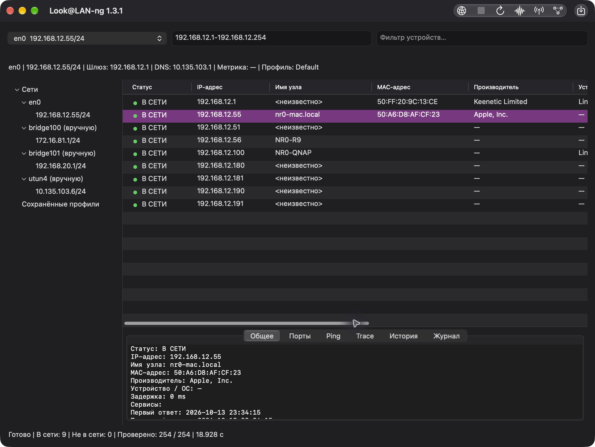
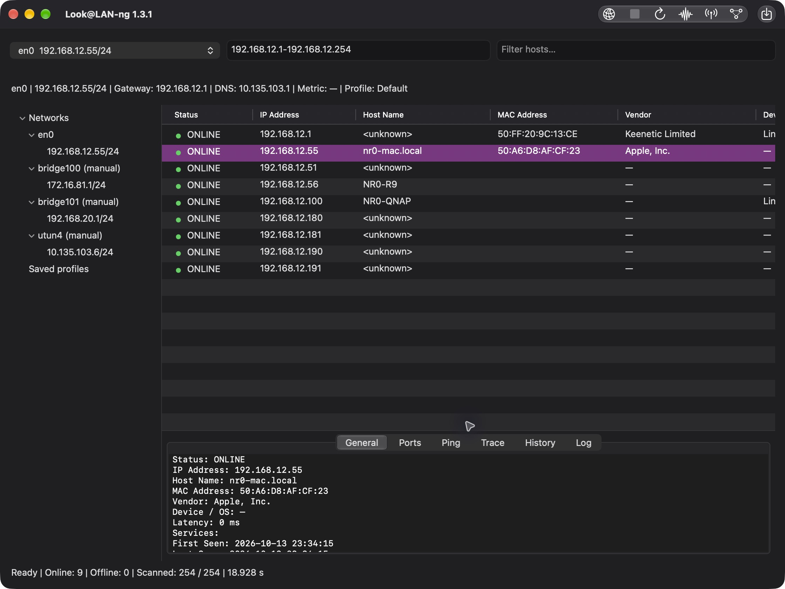

# Look@LAN-ng

**RU:** Компактный сетевой сканер с native интерфейсом, русским и английским языками. Windows, Linux и macOS — без облака, аккаунтов и telemetry.

**EN:** A compact network scanner with native Russian/English interfaces for Windows, Linux and macOS. No cloud, accounts or telemetry.

[Releases / Релизы](https://github.com/nr084/Look-LAN-ng/releases) · [Specification / ТЗ](docs/SPECIFICATION.md) · [Build](BUILD.md) · [Project state](PROJECT_STATE.md)

## Скачать / Download

| Платформа / Platform | Проверенный релиз / Verified release | Поставка / Package |
| --- | --- | --- |
| macOS universal arm64 + x86_64 | [1.3.1](https://github.com/nr084/Look-LAN-ng/releases/tag/v1.3.1) | DMG |
| Linux x64 | [1.3.0](https://github.com/nr084/Look-LAN-ng/releases/tag/v1.3.0) | ZIP |
| Windows x86 / x64 / ARM64 | [1.2.0](https://github.com/nr084/Look-LAN-ng/releases/tag/v1.2.0) | One EXE per architecture ZIP |

Текущий релиз **1.3.1 содержит только macOS**. Windows/Linux история сохранена; новые непроверенные кандидаты не опубликованы.

The current **1.3.1 release contains macOS only**. Existing Windows/Linux releases are preserved; unvalidated development candidates are not published.

## macOS

**RU:** Откройте DMG и перенесите Look@LAN-ng в Applications. Выберите сетевой интерфейс и нажмите «Сканировать». «Стоп» отменяет операцию; результаты появляются постепенно. Язык: «Язык системы» / English / Русский, явный выбор сохраняется. Нативная сборка universal; deployment baseline macOS 13. Приложение подписано ad-hoc, без Developer ID/notarization.

**EN:** Open the DMG and drag Look@LAN-ng to Applications. Select a network interface and click Scan. Stop cancels work; results appear progressively. Language: System language / English / Русский; an explicit selection is saved. Native universal build, macOS 13 deployment baseline. The app is ad-hoc signed, without Developer ID/notarization.

Проверено на macOS 27.0.1 / Apple Silicon: 6/6 arm64 suites, 6/6 Rosetta x86_64 suites, оба final smoke modes, Cocoa GUI и реальное LAN-сканирование. 120 раундов мониторинга (~10 минут): FD 3 → 3, RSS 11664 → max 11696 KiB. Intel hardware и старые macOS не проверены. [Подробные результаты и ограничения](docs/MACOS_VALIDATION.md).

Verified on macOS 27.0.1 / Apple Silicon: six arm64 and six Rosetta x86_64 suites, both final smoke modes, Cocoa GUI and actual LAN discovery. A 120-round monitoring check (~10 minutes) kept FD at 3, RSS 11664 → max 11696 KiB. Intel hardware and older macOS were not tested. [Evidence and limitations](docs/MACOS_VALIDATION.md).

## Возможности / Features

- IPv4 discovery through ARP, ICMP and TCP with the selected source/interface; reverse DNS and NetBIOS fallback, MAC and embedded vendor database.
- Common/custom TCP ports, Single Host, sorting/filtering, cautious device/OS hints.
- Automatic monitoring with ONLINE/OFFLINE/NEW/CHANGED/UNKNOWN, bounded session history/log, statistics, separate Ping and Trace.
- Device notes, UTF-8 profiles and background CSV/TXT/HTML export with immutable snapshots and atomic file replacement.
- Native Win32 / GTK3 / Cocoa; C17 core has no Windows headers. No driver, background service or embedded remote client.

ARP cache alone does not prove ONLINE; OS hints are probabilistic. Device notes/history are session-only; profile notes persist. External Web/SSH/SMB/RDP actions use installed system applications. Active IPv6, future mDNS and disk history are outside the current scope.

## Реальные скриншоты / Actual screenshots

macOS 1.3.1, русский интерфейс, итоговая сборка / Russian UI, final build:



macOS 1.3.1, English UI, final build:



[Windows 1.2.0 screenshot](docs/images/windows-1.2.0.png) · [Linux 1.3.0 screenshot](docs/images/linux-1.3.0.png)

## Development

macOS compilation, packaging and testing run locally on Mac. This workspace builds **macOS only**. Windows/Linux compilation stays local on Windows. GitHub Actions does not compile.

```sh
./tools/build-macos.sh
python3 tools/package-macos.py --release
```

[BUILD.md](BUILD.md) documents dependencies, tests and checked publication. [Windows validation](docs/RELEASE_CHECK.md) and [Linux validation](docs/LINUX_VALIDATION.md) describe their release-specific results. Full OS/NIC/physical DPI/long-load matrices are not claimed complete.

© nr084, build year / год сборки. Copyright year is generated during compilation.
