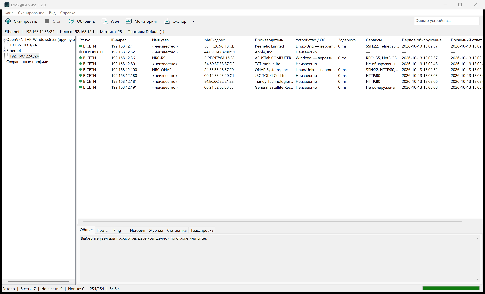
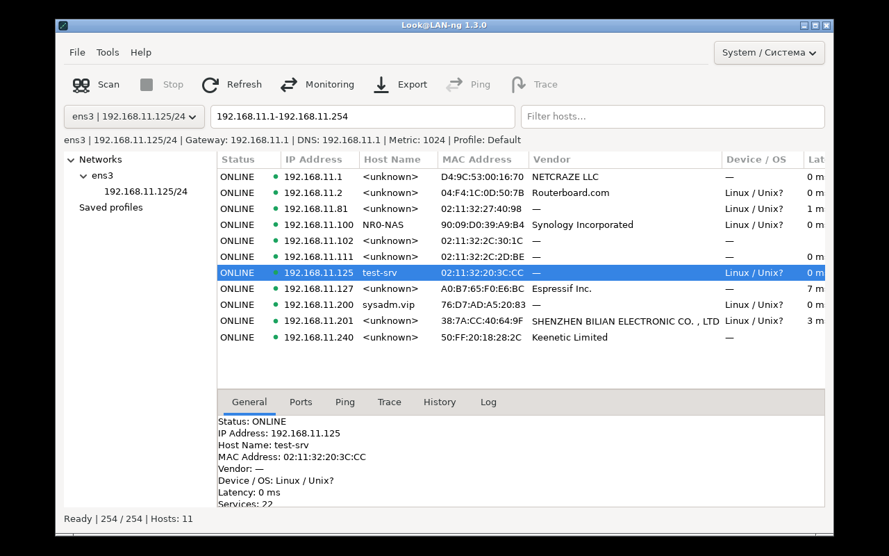

# Look@LAN-ng

**RU:** Компактный LAN-сканер для Windows x86/x64/ARM64 и Linux x64. Русский и английский интерфейс, современный native Win32 с лёгкой ретро-отсылкой.

**EN:** A compact LAN scanner for Windows x86/x64/ARM64 and Linux x64. Russian and English interfaces, modern native Win32 UI with a subtle retro influence.

[Релизы / Releases](https://github.com/nr084/Look-LAN-ng/releases) · [ТЗ / Specification](docs/SPECIFICATION.md) · [Статус / Status](docs/SPEC_STATUS.md) · [Build](BUILD.md)

**Локальная разработка / Local development:** обязательная функциональность
ТЗ реализована для Windows x86/x64/ARM64, Linux x64 и macOS universal.
Кандидат **1.3.1-rc.1** собран локально для всех этих целей; по указанию
пользователя проверки в этом этапе не выполнялись. Это не новый проверенный
stable release; опубликованные Windows 1.2.0 и Linux 1.3.0 сохранены.

Required specification features are implemented for all those targets. Local
**1.3.1-rc.1** candidates were compiled without validation at the user's request;
they are not published as verified stable releases. See [implementation status](docs/SPEC_STATUS.md)
and [candidate notes](docs/DEVELOPMENT_README.txt).

## Русский

### Скачать и запустить

Windows stable 1.2.0 содержит три отдельных ZIP, каждый содержит один `Look@LAN-ng.exe`:

| Архитектура Windows | Файл |
| --- | --- |
| x86, 32-битная | `look@lan-ng-x86-1.2.0.zip` |
| x64, 64-битная Intel/AMD | `look@lan-ng-x64-1.2.0.zip` |
| ARM64 | `look@lan-ng-arm64-1.2.0.zip` |

Скачайте ZIP своей архитектуры со страницы Releases, распакуйте, запустите EXE. Установка, драйверы, права администратора и дополнительные runtime не нужны. Выберите сетевой адаптер и нажмите **Сканировать / F5**. **Стоп / Esc** отменяет операцию.

Язык: **Вид → Язык** → **Язык системы (по умолчанию)**, **English**, **Русский**. Русский язык интерфейса Windows выбирает русский, любой другой — английский. Ручной выбор сохраняется. Настройки portable записываются рядом с EXE; если папка недоступна для записи — в LocalAppData.

### Возможности

- Обнаружение IPv4 через ARP, ICMP и TCP с выбранного интерфейса; результаты появляются постепенно.
- DNS и NetBIOS-имена, MAC, встроенная OUI-база производителей, TCP-порты и осторожные подсказки ОС.
- Один узел, произвольные порты, фильтрация и сортировка; Web/HTTPS/RDP/SSH/SMB и копирование реквизитов.
- Мониторинг ONLINE/OFFLINE/NEW/CHANGED/UNKNOWN, журнал, статистика, отдельные Ping и Trace, заметки устройств.
- UTF-8 профили, CSV/TXT/HTML экспорт, RU/EN интерфейс и DPI 100–200%.
- C17, static CRT, только системные Windows API; без облака, аккаунтов, telemetry и фоновой службы.

Запись ARP-кэша сама по себе не означает ONLINE. OS hints не являются точным fingerprinting. История/заметки устройства сохраняются только в текущей сессии; профильные заметки сохраняются в профиле. SSH требует установленного Windows OpenSSH client. Активное IPv6-сканирование отсутствует. Linux stable доступен ниже; новая macOS-сборка проверяется.

Полная ручная Windows 10/11, physical DPI/NIC, network-failure и длительная LAN-monitoring matrix ещё не выполнена. Автоматические тесты и UPX smoke checks описаны в [RELEASE_CHECK](docs/RELEASE_CHECK.md); они не заменяют эту matrix.

### Сборка и релизы

Visual Studio Build Tools 2022, C++ toolchain нужной архитектуры, Windows SDK, CMake. В PowerShell:

```powershell
./tools/build-windows.ps1 -Architecture x86
./tools/build-windows.ps1 -Architecture x64
./tools/build-windows.ps1 -Architecture arm64
```

Сборка, тесты и максимальное сжатие UPX выполняются локально. Готовые файлы публикуются `tools/publish-local-release.ps1`; для Windows один релиз содержит три отдельных ZIP. SHA-256 включаются в описание релиза. GitHub Actions не компилирует приложение.

## English

### Download and run

Windows stable 1.2.0 provides three separate ZIP files, each containing one `Look@LAN-ng.exe`:

| Windows architecture | File |
| --- | --- |
| x86, 32-bit | `look@lan-ng-x86-1.2.0.zip` |
| x64, 64-bit Intel/AMD | `look@lan-ng-x64-1.2.0.zip` |
| ARM64 | `look@lan-ng-arm64-1.2.0.zip` |

Download the ZIP matching your architecture from Releases, extract it and run the executable. No installation, drivers, administrator privileges or additional runtimes are required. Select a network adapter and press **Scan / F5**. **Stop / Esc** cancels the operation.

Language: **View → Language** → **System language (default)**, **English**, **Русский**. Russian Windows UI selects Russian; every other language selects English. Manual selection is saved. Portable settings are stored next to the executable, with a LocalAppData fallback if the folder is not writable.

### Features

- IPv4 discovery using source-bound ARP, ICMP and TCP; incremental results.
- DNS and NetBIOS names, MAC addresses, embedded OUI vendor lookup, TCP ports and cautious OS hints.
- Single-host and custom-port scans, filtering and sorting; Web/HTTPS/RDP/SSH/SMB and copy actions.
- ONLINE/OFFLINE/NEW/CHANGED/UNKNOWN monitoring, event log, statistics, standalone Ping and Trace, device notes.
- UTF-8 profiles, CSV/TXT/HTML export, RU/EN interface and DPI 100–200%.
- C17, static CRT and system Windows APIs only; no cloud, accounts, telemetry or background service.

An ARP cache entry alone does not establish ONLINE status. OS hints are not exact fingerprinting. Device notes and history are session-only; profile notes persist in the profile. SSH requires Windows OpenSSH client. Active IPv6 scanning is absent. Linux stable is available below; the new macOS build awaits native testing.

The complete manual Windows 10/11, physical DPI/NIC, network-failure and long-running LAN monitoring matrix remains untested. See [RELEASE_CHECK](docs/RELEASE_CHECK.md) for automated tests and UPX smoke checks; these do not replace the manual matrix.

### Build and release

Use Visual Studio Build Tools 2022 with the target C++ architecture toolchain, Windows SDK and CMake. Run `tools/build-windows.ps1 -Architecture x86`, `x64` or `arm64` in PowerShell.

Build, tests and maximum UPX compression run locally. Publish completed files with `tools/publish-local-release.ps1`; Windows releases contain three architecture ZIPs and SHA-256 in the release notes. GitHub Actions does not compile the application.

© nr084, build year / год сборки. Original Look@LAN code, logo and assets are not used.

## Linux / macOS

**RU:** [Linux x64 stable 1.3.0](https://github.com/nr084/Look-LAN-ng/releases/tag/v1.3.0): ZIP, запуск `./LookLAN.sh`, системные GTK 3 libraries. Native ARP/ICMP/TCP, DNS/NetBIOS, Ping/Trace, мониторинг, журнал/история/статистика, профили, CSV/TXT/HTML, RU/EN. Проверено на Ubuntu 26.04.1 VM: шесть native suites, 39 GUI сценариев и 120 monitoring rounds. [Доказательства и ограничения](docs/LINUX_VALIDATION.md). Ubuntu 22.04 остаётся build baseline. macOS 13+ universal Intel/Apple Silicon DMG собирается локально, новый кандидат rc.3 остаётся локальным до native проверки; работа прежней port.1 подтверждена пользователем.

**EN:** [Linux x64 stable 1.3.0](https://github.com/nr084/Look-LAN-ng/releases/tag/v1.3.0): extract and run `./LookLAN.sh` with system GTK 3. Native discovery, async names, Ping/Trace, monitoring, native log/history/statistics, profiles/export and RU/EN. Tested on Ubuntu 26.04.1: six native suites, 39 GTK workflows and 120 scheduled monitoring rounds. [Evidence/limitations](docs/LINUX_VALIDATION.md). Ubuntu 22.04 is a build baseline. The locally built macOS 13+ universal candidate remains private until native user validation; earlier port.1 startup/discovery was confirmed.

### Real release screenshots / Снимки реальных релизов

Windows 1.2.0 — published packed EXE, actual LAN scan / опубликованный packed EXE, реальное сканирование:



Linux 1.3.0 — final packed release build, actual subnet scan / окончательная сборка, реальное сканирование:



macOS screenshot will be provided by the user / скриншот macOS предоставит пользователь.

Compilation/packaging run locally on Windows. GitHub Actions does not compile. Port preview releases are withheld; publication checks exact-asset native validation. © nr084, build year / год сборки.
