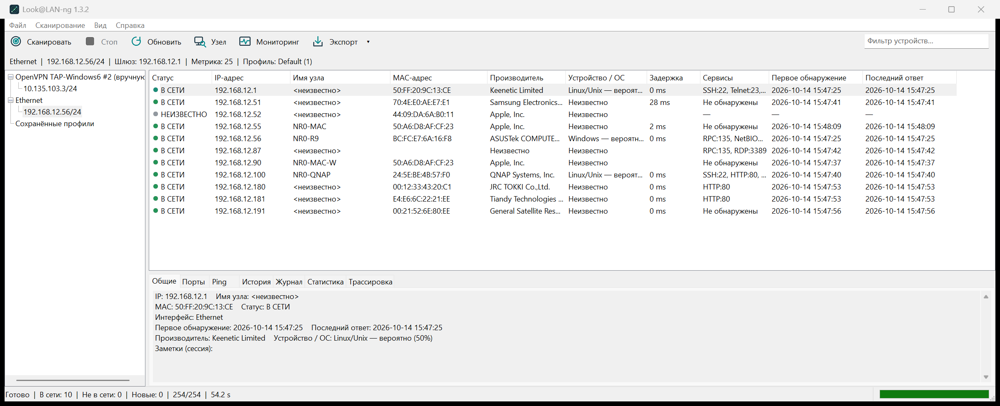
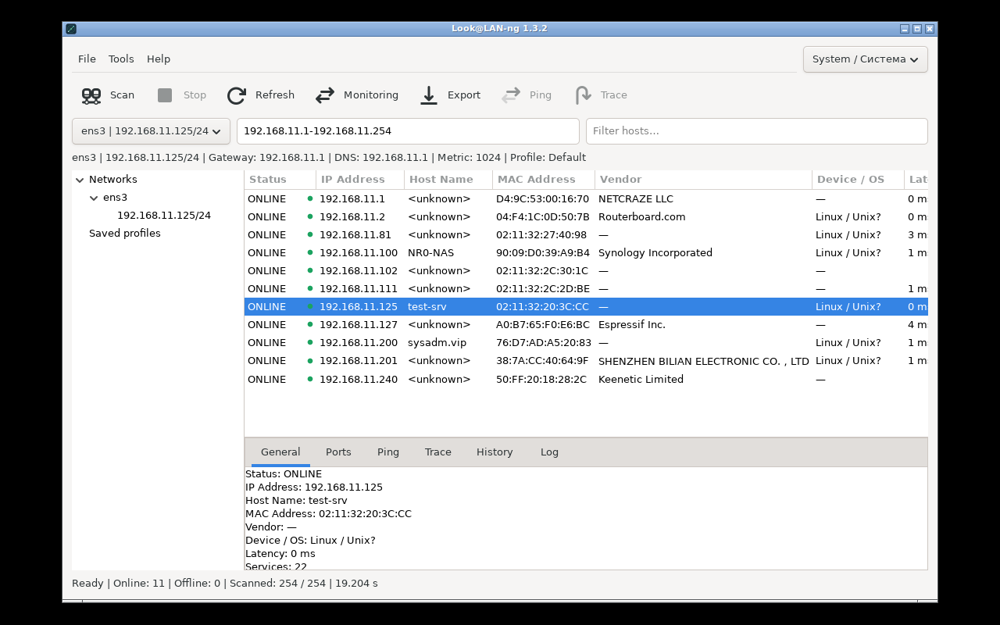
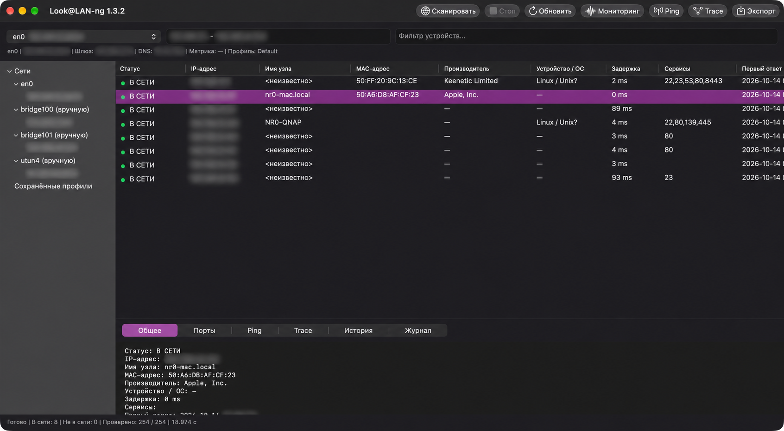

# Look@LAN-ng

**RU:** Компактный LAN-сканер и монитор сети для Windows, Ubuntu/Linux и macOS.
Native интерфейс, русский и английский языки. Без облака, аккаунтов, telemetry,
драйверов и фоновых служб.

**EN:** A compact LAN scanner and network monitor for Windows, Ubuntu/Linux and
macOS. Native Russian/English interfaces. No cloud, accounts, telemetry, drivers
or background services.

[Release 1.3.2](https://github.com/nr084/Look-LAN-ng/releases/tag/v1.3.2) ·
[Build](BUILD.md) · [Specification / ТЗ](docs/SPECIFICATION.md) ·
[Implementation status](docs/SPEC_STATUS.md)

## Скачать / Download

| Платформа / Platform | Архитектура / Architecture | Файл / File |
| --- | --- | --- |
| Windows | x86 | [ZIP](https://github.com/nr084/Look-LAN-ng/releases/download/v1.3.2/look%40lan-ng-x86-1.3.2.zip) |
| Windows | x64 | [ZIP](https://github.com/nr084/Look-LAN-ng/releases/download/v1.3.2/look%40lan-ng-x64-1.3.2.zip) |
| Windows | ARM64 | [ZIP](https://github.com/nr084/Look-LAN-ng/releases/download/v1.3.2/look%40lan-ng-arm64-1.3.2.zip) |
| Ubuntu/Linux | x64 | [ZIP](https://github.com/nr084/Look-LAN-ng/releases/download/v1.3.2/look%40lan-ng-linux-x64-1.3.2.zip) |
| macOS | Universal Intel + Apple Silicon | [DMG](https://github.com/nr084/Look-LAN-ng/releases/download/v1.3.2/look%40lan-ng-macos-universal-1.3.2.dmg) |

**Windows:** распакуйте один EXE своей архитектуры и запустите его. Установка и
права администратора не нужны. / Extract the single EXE for your architecture
and run it; no installer or administrator rights required.

**Ubuntu/Linux:** распакуйте ZIP и запустите `./LookLAN.sh`. Нужны графическая
сессия и системные GTK 3 libraries. Ubuntu 22.04+ — цель сборки; native-проверки
выполнены на Ubuntu 26.04.1 x64. / Extract and run `./LookLAN.sh` with system
GTK 3 libraries. Ubuntu 22.04+ is the build baseline; runtime checks used 26.04.1.

**macOS:** откройте DMG и перенесите приложение в Applications. Цель сборки —
macOS 13+, подпись ad-hoc, без notarization. / Open the DMG and drag the app to
Applications. macOS 13+ deployment baseline; ad-hoc signed, not notarized.

Выберите сетевой интерфейс → **Сканировать**. Результаты появляются постепенно;
**Стоп** отменяет работу. / Select an interface → **Scan**. Hosts appear
progressively; **Stop** cancels work.

Язык по умолчанию: русская система → русский, остальные → английский.
System / English / Русский можно выбрать вручную; выбор сохраняется.
/ Russian system locale defaults to Russian; all others to English. A saved
System / English / Русский override is available.

## Возможности / Features

- ARP, ICMP и TCP discovery с выбранного интерфейса; асинхронные DNS/NetBIOS,
  MAC и встроенная база производителей. / Selected-interface discovery,
  asynchronous naming, MAC and embedded vendor lookup.
- Один узел, common/custom TCP-порты, сортировка, фильтр и подсказки ОС.
  / Single Host, common/custom TCP ports, sorting, filtering and cautious OS hints.
- Мониторинг ONLINE/OFFLINE/NEW/CHANGED/UNKNOWN, ограниченный журнал и история,
  статистика, Ping/Trace и заметки устройства. / Monitoring, bounded session
  logs/history, statistics, Ping/Trace and device notes.
- UTF-8 профили, фоновый атомарный CSV/TXT/HTML export.
  / UTF-8 profiles and background atomic CSV/TXT/HTML export.
- Native Win32 / GTK3 / Cocoa; переносимое C17 core. Все сборки локальные:
  Windows/Linux на Windows, macOS на Mac. GitHub Actions только запускает
  готовые ARM64 файлы; не компилирует. / Local compilation, with runtime-only
  ARM64 verification on GitHub.

ARP-кэш сам по себе не доказывает ONLINE; определение ОС вероятностное.
Заметки и история устройств — текущей сессии, заметки профиля сохраняются.
Web/SSH/SMB/RDP используют установленные системные приложения. mDNS, активное
IPv6-сканирование и история на диске остаются будущими функциями.
/ Cached neighbors do not prove ONLINE; OS hints are probabilistic. Device
notes/history are session-only, profile notes persist. External actions use
installed system applications. mDNS, active IPv6 and disk history remain future work.

## Реальные скриншоты / Actual screenshots

Окончательные сборки 1.3.2 после реального LAN-сканирования, без демонстрационных
данных. / Final 1.3.2 builds after actual LAN scans, without sample data.

**Windows, RU**

**Ubuntu, EN**

**macOS, RU**

[macOS English screenshot](docs/images/macos-1.3.2-en.png)

## Проверки и ограничения / Validation and limits

Windows x86/x64: по 15 CTest и четыре packed smoke modes на Windows 11 x64.
ARM64: 11 локально скомпилированных C suites и четыре packed smoke modes
на нативном Windows 11 ARM64 [runner](https://github.com/nr084/Look-LAN-ng/actions/runs/38566307932).
UPX 5.2.1, `--ultra-brute --lzma`, integrity и запуск проверены.

Linux: шесть native C suites, 39 GTK workflows и packed startup на Ubuntu VM.
100 Scan/Stop cycles: FD 6 → 6, максимальный Stop 12 ms. Ubuntu 22.04 runtime,
physical HiDPI/NIC unplug и длительная матрица не проверены.

macOS: native arm64 и Rosetta x86_64 suites, подписанный app smoke, Cocoa GUI,
реальный LAN scan и DMG проверки на Apple Silicon. Intel hardware и старые
macOS не проверены. UPX не поддерживает Mach-O; DMG сжат ULMO/LZMA.

These checks cover the stated environments, not a complete Windows 10/11,
physical DPI/NIC or long-runtime matrix. Rosetta results do not replace Intel
hardware testing. See [Windows/Linux 1.3.2 validation](docs/WINDOWS_LINUX_VALIDATION_1.3.2.md)
and [macOS validation](docs/MACOS_VALIDATION.md) for exact evidence and limits.

© nr084 — год copyright вычисляется при сборке / copyright year generated at build time.
