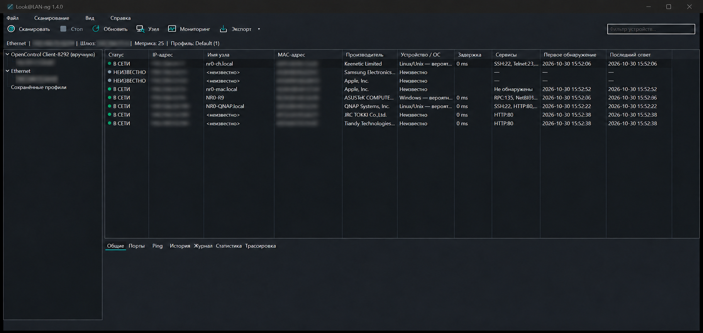
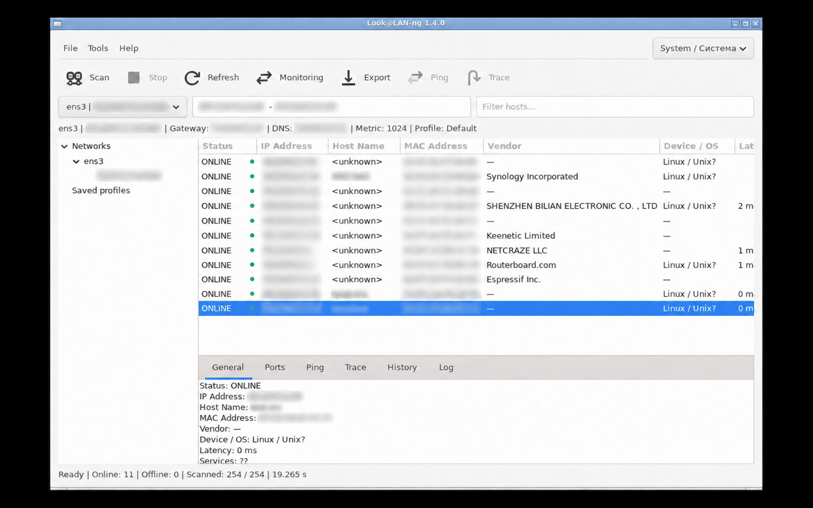
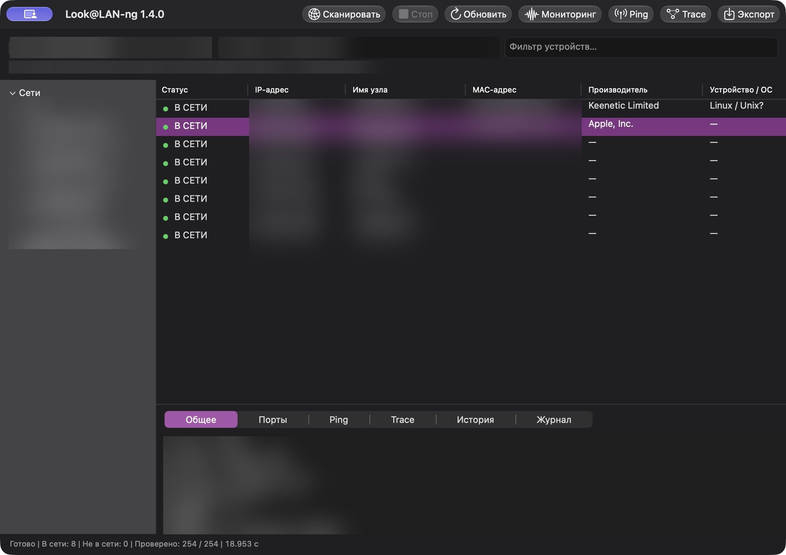
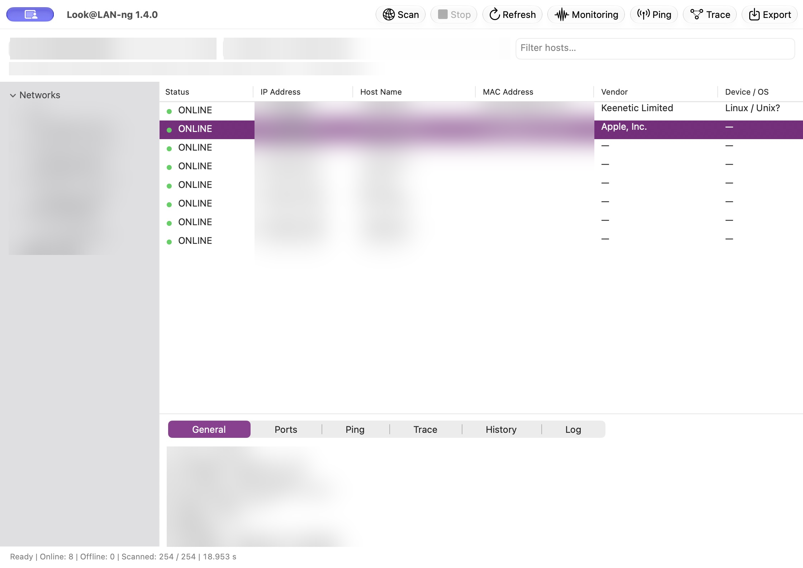

# Look@LAN-ng

**RU:** Портативный LAN-сканер и монитор сети с нативным интерфейсом на русском и английском. Windows x86/x64/ARM64, Ubuntu/Linux x64; macOS universal собирается и публикуется отдельно на Mac. Без облака, аккаунтов, телеметрии, драйверов и фоновых служб.

**EN:** A portable LAN scanner and network monitor with native Russian/English interfaces. Windows x86/x64/ARM64 and Ubuntu/Linux x64; macOS universal is built and published separately on Mac. No cloud, accounts, telemetry, drivers or background services.

[Release 1.4.0](https://github.com/nr084/Look-LAN-ng/releases/tag/v1.4.0) · [Build / Сборка](BUILD.md) · [Profiles and history / Профили и история](docs/PROFILES.md) · [Validation / Проверки](docs/VALIDATION_1.4.0.md)

## Скачать / Download

| Платформа / Platform | Архитектура / Architecture | Поставка / Package |
| --- | --- | --- |
| Windows | x86 | [ZIP](https://github.com/nr084/Look-LAN-ng/releases/download/v1.4.0/look%40lan-ng-x86-1.4.0.zip) |
| Windows | x64 | [ZIP](https://github.com/nr084/Look-LAN-ng/releases/download/v1.4.0/look%40lan-ng-x64-1.4.0.zip) |
| Windows | ARM64 | [ZIP](https://github.com/nr084/Look-LAN-ng/releases/download/v1.4.0/look%40lan-ng-arm64-1.4.0.zip) |
| Ubuntu/Linux | x64 | [ZIP](https://github.com/nr084/Look-LAN-ng/releases/download/v1.4.0/look%40lan-ng-linux-x64-1.4.0.zip) |
| macOS | universal arm64 + x86_64 | [DMG](https://github.com/nr084/Look-LAN-ng/releases/download/v1.4.0/look%40lan-ng-macos-universal-1.4.0.dmg) |

Один Windows ZIP содержит один EXE. Linux: распакуйте ZIP и запустите `./LookLAN.sh` в графической сессии с GTK 3. / Each Windows ZIP contains one EXE. On Linux, extract the ZIP and run `./LookLAN.sh` in a graphical session with GTK 3.

<!-- macos-release -->
macOS 1.4.0 universal arm64+x86_64 собрана и проверена на Mac: [DMG](https://github.com/nr084/Look-LAN-ng/releases/download/v1.4.0/look%40lan-ng-macos-universal-1.4.0.dmg). / Native Mac-built and tested universal DMG is included in the same release.
<!-- /macos-release -->

## Возможности / Features

- ARP/ICMP/TCP discovery, DNS/NetBIOS, MAC/IEEE OUI, TCP-порты, вероятностная ОС. / Discovery, names, vendor lookup, TCP ports and cautious OS hints.
- Мониторинг, NEW/CHANGED/OFFLINE, Ping/Trace, история, журнал, фильтр, сортировка и экспорт CSV/TXT/HTML. / Monitoring, host changes, diagnostics, history, log, filtering, sorting and export.
- По умолчанию русский для русской системы, английский для остальных; ручной выбор System/English/Русский. / Russian for Russian systems, English otherwise; an explicit language override is available.

- Windows: Вид → Тема → Системная / Светлая / Тёмная. По умолчанию используется тема Windows; выбор сохраняется только после сохранения профиля. / View → Theme → System / Light / Dark. Defaults to Windows appearance; the preference persists only after saving a profile.

## Временный запуск и профиль / Temporary use and profiles

Просто запустите приложение и сканируйте: INI и каталоги настроек не создаются. Успешное «Сохранить профиль» включает постоянный режим. Профили находятся в `profiles` рядом с приложением (macOS: `~/Library/Application Support/LookLAN-ng/profiles`); единственный профиль выбирается автоматически при запуске. В Windows при недоступной для записи папке используется `%LOCALAPPDATA%\Look@LAN-ng\profiles`.

Just launch and scan: no INI or settings directories are created. Successfully saving a profile enables persistent mode. Profiles live in `profiles` beside the application (macOS: `~/Library/Application Support/LookLAN-ng/profiles`); a sole profile is selected automatically at startup. Windows can fall back to `%LOCALAPPDATA%\Look@LAN-ng\profiles` when the portable folder is not writable.

Профиль v2: настройки `.lanprofile` и связанная история `.lanprofile.lanhistory`. Сохраняются хосты, MAC/имя, порты, первое/последнее обнаружение, отметки NEW/CHANGED и последние 10 000 событий. История продолжается при следующих сканированиях и мониторинге. Восстановленные строки имеют статус HISTORY/ИСТОРИЯ до новой проверки. Заметки устройств и отдельные Ping/Trace-пробы остаются в памяти текущего запуска. Старые профили v1 не поддерживаются; миграции нет.

Profile v2 consists of `.lanprofile` settings and an associated `.lanprofile.lanhistory` snapshot. Hosts, MAC/name, ports, first/last seen, NEW/CHANGED flags and the latest 10,000 events persist across scans and monitoring sessions. Restored rows show HISTORY until checked again. Device notes and individual Ping/Trace samples remain session-only. Legacy v1 profiles are unsupported; no migration is performed.

## Скриншоты / Screenshots

Финальные сборки после реального LAN-сканирования; IP и MAC скрыты размытием. / Final builds after actual LAN scans; IP and MAC addresses are blurred.

**Windows, RU, тёмная тема / dark theme**

**Ubuntu, EN**

**macOS RU/Dark и EN/Light — реальные результаты / actual results**

## Сборка и проверки / Build and validation

Windows и Linux компилируются локально на Windows. Перед каждой сборкой официально проверяется и используется последний stable Clang/LLVM-MinGW и заново загружается база IEEE MA-L. Ошибка проверки останавливает сборку. Максимальное сжатие stable UPX: `--ultra-brute --lzma`, затем integrity и запуск. Несжатые диагностические файлы остаются локально.

Windows and Linux are compiled locally on Windows. Every build verifies the latest official stable Clang/LLVM-MinGW and refreshes IEEE MA-L data; failed checks stop the build. Stable UPX uses maximum compression followed by integrity and startup checks; raw diagnostic binaries stay local. Actions only validates prebuilt ARM64 binaries, without compilation.

Runtime coverage: Windows 11 x64, native Windows 11 ARM64 runner, Ubuntu 26.04.1 x64 VM and macOS 27.2 Apple Silicon. Mac: 9/9 native and 9/9 Rosetta tests, actual LAN, profiles/history, monitoring and exports passed. Native Intel/older macOS and full physical DPI/NIC matrices remain untested. [Windows/Linux evidence](docs/VALIDATION_1.4.0.md) · [Mac evidence](docs/MACOS_VALIDATION.md).

© nr084 — год вычисляется при сборке / year generated at build time.

macOS: `tools/build-macos.sh` checks stable LLVM and IEEE before every native universal build; `tools/package-macos.py --release` signs and validates the compressed DMG. Cocoa supports System/Light/Dark; a saved profile enables persistent settings. The Mac DMG is added to the existing release without replacing its Windows/Linux ZIPs or tag.
