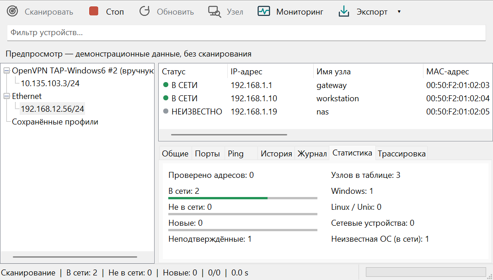

# Look@LAN-ng

Компактный портативный сканер локальной сети для Windows 10/11 x64, написанный на C17 и Win32. Интерфейс на русском и английском: обычные меню, дерево сетей, таблица устройств и нижняя панель сведений. Современная системная типографика и лёгкий налёт классических сетевых утилит. Код и графические ресурсы оригинального Look@LAN не используются.

## Local Windows x64 snapshot 1.2.0 (before GitHub publication)

1. Распакуйте `dist/Look@LAN-ng-1.2.0-win64.zip` или запустите `dist/1.2.0/Look@LAN-ng.exe`.
2. Выберите Ethernet или Wi-Fi в дереве. Подходящий физический адаптер выбирается заранее.
3. Нажмите **Сканировать / Scan** или F5.
4. Устройства появляются по мере обнаружения. Выберите строку или сделайте двойной щелчок для просмотра сведений. Esc останавливает выдачу новых заданий.

ARP-кэш показывается сразу, но его записи имеют статус UNKNOWN до подтверждения активной проверкой. При отсутствии ARP/ICMP используются TCP probes; успешное подключение или connection refused подтверждает наличие устройства. Reverse DNS выполняется отдельно и не задерживает завершение сканирования.

Производитель MAC определяется по встроенной IEEE OUI-базе. Common services отображаются по открытым TCP-портам. **Отдельный узел / Single Host** принимает IP или hostname. В контекстном меню доступны quick/custom port scan, Web/HTTPS/RDP/SMB и копирование реквизитов. Поле справа на toolbar фильтрует таблицу. OS/device — осторожная вероятностная подсказка, а не точное fingerprinting.

В 1.1 исправлено главное окно: отключённые кнопки читаются полностью, их высота учитывает DPI/font, дерево не сереет во время сканирования; смена NIC блокируется без отключения TreeView. Toolbar доступен с клавиатуры и имеет tooltips.

## Диагностика и заметки устройств

Контекстные **Ping** и **Трассировка / Traceroute** запускаются в фоне. Ping отправляет четыре Echo с интервалом около секунды; вкладка Ping показывает последние результаты выбранного IP/интерфейса, включая пробы обычного сканирования. Общая история ограничена 10000 samples, панель выводит до 60 последних совпадений. Trace увеличивает TTL от 1 до 30, показывает адрес/RTT/status или `*`, останавливается при достижении цели. **Стоп** отменяет диагностику, закрытие ждёт безопасной очистки; monitoring rounds приостанавливаются на время диагностики.

После неудачного reverse DNS выполняется bounded unicast NetBIOS Node Status query (UDP 137, 300 ms) с выбранного source IP. Имя workstation принимается только из корректного ответа нужного IP/port/transaction. NetBIOS не считается доказательством ONLINE в модели; OEM-имя преобразуется в UTF-8.

**Open SSH / Открыть SSH** использует системный Windows OpenSSH client, если установлен, и спрашивает необязательное имя пользователя. Клиент не входит в runtime dependencies сканера; credentials не сохраняются. **Заметки устройства / Device notes** показываются в General, хранятся для IP/интерфейса в текущей сессии (до 511 UTF-8 bytes, 1024 устройств). Смена NIC/профиля очищает заметки и ping history; заметки профиля отдельно сохраняются в `.lanprofile`.

## Профили, отчёты и статистика

В меню **Файл / File** можно создать, открыть, изменить и сохранить профиль `.lanprofile` (Ctrl+O / Ctrl+S). Профиль хранит имя, интерфейс, несколько диапазонов IPv4, TCP-порты, таймауты, число workers, интервал мониторинга и заметки. Диапазоны задаются по одному на строку: `192.168.1.1-254`, `192.168.2.0/24` или отдельный IP. Пересечения объединяются; один адрес проверяется один раз. При недоступном сохранённом интерфейсе выберите подходящий NIC вручную.

Профили сохраняются в `profiles` рядом с EXE; при запрете записи используется `%LOCALAPPDATA%\Look@LAN-ng\profiles`. Формат и пределы описаны в [docs/PROFILES.md](PROFILES.md). Открытие профиля не запускает сканирование автоматически; новый или изменённый профиль начинает новую сессию.

**Экспорт / Export** сохраняет CSV, TXT или самостоятельный HTML на русском либо английском языке. Отчёт содержит все строки текущей сессии, включая OFFLINE/UNKNOWN, независимо от фильтра. Даты указаны в UTC. Запись выполняется в фоне по снимку данных; отмена или ошибка сохраняет прежний файл. Вкладка **Статистика / Statistics** показывает состояния устройств и распределение online-узлов по OS hints.

## Мониторинг

После сканирования нажмите **Мониторинг / Monitoring**. По умолчанию следующий цикл начинается через 30 секунд после завершения предыдущего; циклы не пересекаются. В **Вид → Интервал мониторинга** доступны 5/10/30/60/300 секунд. Приложение не включает мониторинг автоматически при запуске.

Новые устройства получают статус NEW, изменения MAC/имени — CHANGED, исчезнувшие после двух завершённых безответных проверок — OFFLINE. Поздний DNS или запись ARP-кэша не возвращает OFFLINE-узел в ONLINE. **История / History** показывает события выбранного IP, **Журнал / Log** — последние 10000 событий текущей сетевой сессии. Контекстное действие **Отметить просмотренным / Mark as seen** снимает NEW/CHANGED; **Повторно проверить узел / Rescan Host** сохраняет историю и проверяет выбранный адрес. Stop отключает мониторинг и отменяет текущие задания.

Повторные циклы используют до 16 workers вместо 64, не повторяют service scan и выполняют TCP fallback только для ранее известных адресов. Новые LAN-устройства ищутся по свежим ARP/ICMP-ответам. Смена интерфейса начинает новую сессию; история и журнал пока не сохраняются на диск.

Нет установки, аккаунтов, облака, драйверов и внешнего runtime. EXE собран со статическим CRT и манифестом `asInvoker`. Язык переключается через **Вид → Язык / View → Language**. Настройки языка и ширины колонок сохраняются в `Look@LAN-ng.ini` рядом с EXE; при запрете записи используется `%LOCALAPPDATA%\Look@LAN-ng`. Ошибка сохранения не мешает сканеру работать.

© nr084, год сборки — в «О программе» и свойствах EXE.

## Сборка

В PowerShell из каталога проекта:

```powershell
cmd /c tools\build.cmd
```

Нужны Visual Studio Build Tools 2022 с C++ build tools, Windows SDK и компонентом CMake/Ninja. Подробности в [BUILD.md](../BUILD.md).

## Проверки и ограничения релиза

Stable выпущен по явному решению пользователя с перечислением непроверенных пунктов. 15/15 automated tests прошли на Windows build 26300, включая реальные own-IP Ping/Trace. Отдельные Windows 10/11, перенос между физическими мониторами, Wi-Fi/Ethernet matrix и длительные LAN-сессии ещё не проверены. Это не подтверждение всех пунктов исходного DoD. Подробности: [docs/SPEC_STATUS.md](SPEC_STATUS.md), [docs/RELEASE_CHECK.md](RELEASE_CHECK.md) и [PROJECT_STATE.md](../PROJECT_STATE.md).

Stop прекращает ожидание рабочих потоков ARP/ICMP и отменяет DNS. Незавершённые Windows-вызовы остаются в ограниченных фоновых пулах: 16 ARP workers/256 requests и до 256 ICMP requests. Закрытие окна ждёт безопасной очистки через timer UI; остаток ARP/ICMP timeout может задержать закрытие, интерфейс остаётся responsive. DNS имеет лимит ожидания 3 секунды с отменой по Stop/generation/shutdown. Прерванный или ошибочный цикл не считается пропуском устройства. Общий темп проб ограничен приблизительно 250/s для initial scan и 62.5/s для monitoring, без burst.

Активное сканирование IPv4; optional IPv6 neighbor display и future mDNS отсутствуют. Порты определяются по TCP connect, OS — вероятностная подсказка. Runtime не обращается к облаку; обновление vendor database и UPX выполняется только разработчиком. История/заметки устройства не сохраняются на диск.



Это native preview с sample data, без сетевого сканирования. Оригинальный значок хранится в SVG и multi-resolution ICO; генератор: `tools/generate-icons.ps1`.

EXE сжат stable UPX 5.2.1 с `--ultra-brute --lzma`, проверен через `upx -t` и smoke-тест запуска. Начиная с v0.3 GUARD_CF убран по прямому указанию пользователя для совместимости с UPX; ASLR и NX сохранены. Политика будущих поставок и точные размеры/hash — в [docs/RELEASES.md](RELEASES.md) и `dist/release-info.json`.


В 1.2 добавлены оригинальные геометрические toolbar icons (radar/stop/refresh/host/monitor/export), сглаженные supersampling 4x и масштабируемые вместе с DPI. Подписи, отключённые состояния и keyboard focus сохранены. В узком окне фильтр переносится на вторую строку.

Язык: **Вид → Язык / View → Language** → **Язык системы / System language (default)**, **English**, **Русский**. По умолчанию язык определяется по Windows UI language: русский → русский, любой другой → английский. Выбор применяется сразу и записывается в INI как `system`, `ru` или `en`; system mode остаётся автоматическим при следующих запусках. Ранее сохранённый явный выбор ru/en сохраняется. Profile editor, меню, таблица, вкладки, статистика, ошибки и диалоги используют выбранный язык; пользовательские имена/данные не переводятся.
