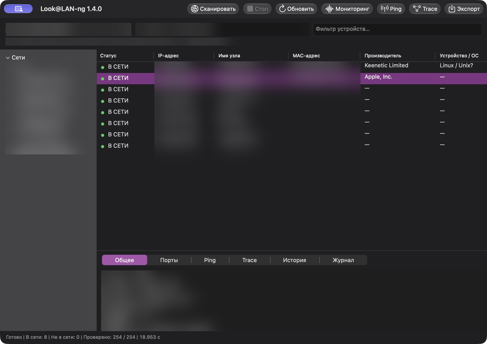
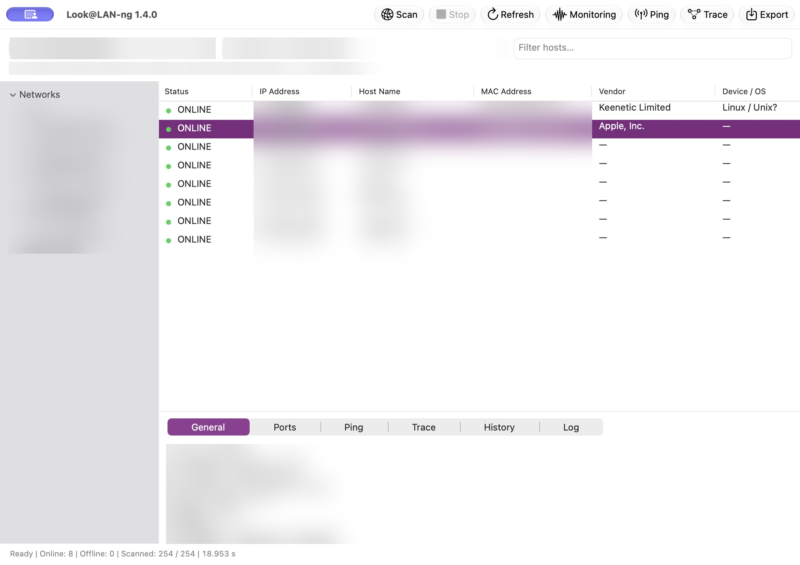
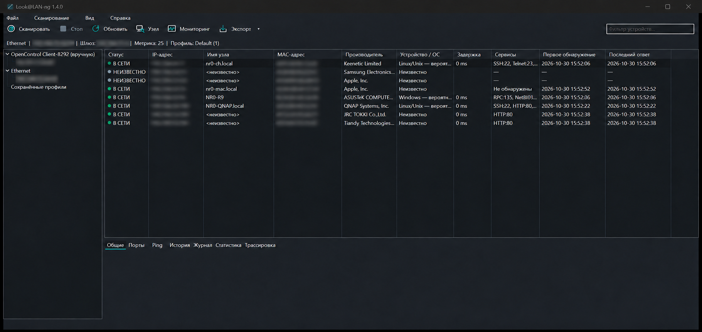
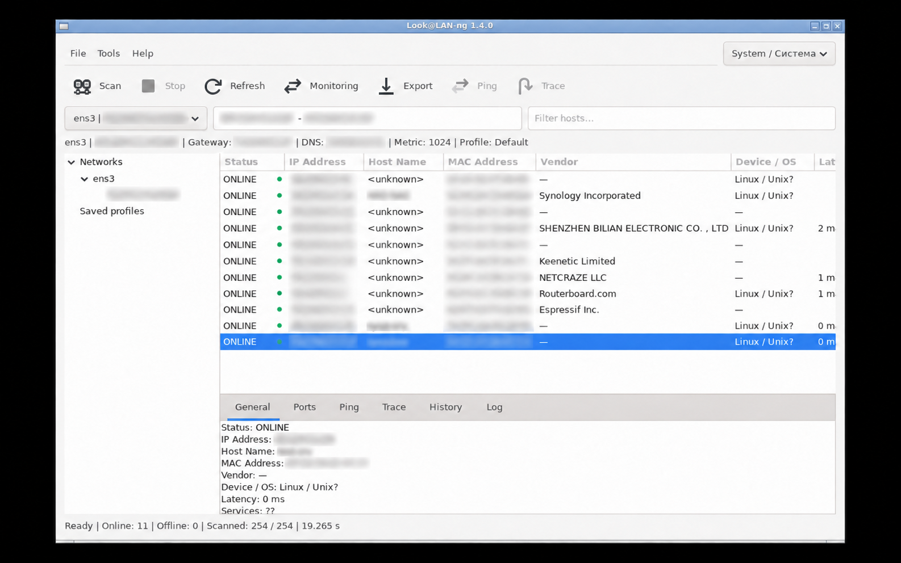

# Look@LAN-ng 1.4.0

## Русский

- Windows: тёмная и светлая темы, Вид → Тема. По умолчанию — системная; ручной выбор сохраняется только в постоянном режиме. Убрана белая полоса между меню и кнопками.
- Временный запуск и сканирование не создают INI и каталоги настроек. «Сохранить профиль» включает сохранение настроек.
- Профили v2 в `profiles`; единственный профиль выбирается при старте. История хостов и последние 10 000 событий продолжаются после перезапуска и при мониторинге. Файлы `.lanprofile` и `.lanprofile.lanhistory` нужно переносить вместе. Старые профили не поддерживаются.
- Последние stable compiler и IEEE MAC база проверяются перед каждой сборкой. LLVM 23.1.4, LLVM-MinGW 20261020, IEEE MA-L 40 421; максимальное сжатие UPX 5.3.0.
- Обновлены описание и реальные Windows/Ubuntu скриншоты с размытыми IP и MAC.

## English

- Windows System/Light/Dark themes in View → Theme. System is the default; explicit preference is saved only in persistent mode. Removed the white menu/toolbar separator.
- Temporary scans create no INI or settings directories. Successfully saving a profile enables settings persistence.
- Profile v2 in `profiles`, automatic selection of a sole profile, persistent host snapshots and the latest 10,000 events across scans/monitoring. Keep `.lanprofile` and `.lanprofile.lanhistory` together. Legacy profiles are unsupported.
- Every build checks the latest stable compiler and refreshes IEEE MAC data. LLVM 23.1.4, LLVM-MinGW 20261020, 40,421 MA-L prefixes; maximum UPX 5.3.0 compression.
- Updated bilingual description and actual Windows/Ubuntu screenshots with blurred IP and MAC addresses.

## Проверки / Validation

Windows x86/x64: 17 tests each and four packed smokes. Native Windows ARM64: 13 suites and four packed smokes. Ubuntu 26.04.1 x64: nine native suites, 39 GTK workflows, real LAN scanning, 100 Scan/Stop cycles. Windows profile/theme GUI: 25 checks.

Windows 10/full hardware/physical DPI/older Ubuntu matrices remain untested. / Полная аппаратная матрица, Windows 10, физические DPI и старые Ubuntu не проверены. Заметки устройств и отдельные Ping/Trace-пробы не сохраняются / Device notes and individual Ping/Trace samples remain session-only.

<!-- macos-release -->
## macOS 1.4.0 — RU

Добавлена проверенная на Mac universal-поставка **arm64+x86_64**. Перенесены профили v2, временный режим без INI/каталогов настроек, постоянный режим после Save Profile и восстановление хостов/журнала после перезапуска. Cocoa: Вид → Тема → Системная / Светлая / Тёмная; выбор сохраняется только в постоянном режиме. Старый профиль отклоняется без миграции и перезаписи.

Clang 23.1.4, свежая официальная IEEE MA-L 40421. Проверены 9/9 ARM64 и 9/9 Rosetta тестов, оба запуска подписанного app, реальная LAN 254/254 (8 узлов), RU/EN, мониторинг, CSV/TXT/HTML, Save Profile v2 и восстановление истории. Скриншоты финального app: все IP/MAC сильно размыты и проверены.

## macOS 1.4.0 — EN

Added the Mac-built and tested **arm64+x86_64** universal DMG. Includes profile v2, temporary use without settings files/directories, persistence after Save Profile, and host/event history restored across restarts. Cocoa View → Theme → System / Light / Dark; preferences persist only after enabling saved-profile mode. Legacy profiles are rejected without migration or overwriting.

Official stable Clang 23.1.4 and freshly retrieved IEEE MA-L 40421. Nine ARM64 and nine Rosetta tests, both signed-app smokes, actual LAN, RU/EN, monitoring, CSV/TXT/HTML, profile saving and history restoration passed. All IP/MAC address regions in the final-app screenshots are strongly blurred and reviewed.

macOS 13 deployment baseline; native Intel and older macOS not tested. Ad-hoc signed, not notarized. No supported macOS UPX packing; Mach-O retained, DMG ULMO/LZMA. Mac diagnostics stay local. Existing Windows/Linux assets and tag are preserved.

| DMG | SHA-256 |
| --- | --- |
| `look@lan-ng-macos-universal-1.4.0.dmg` | `f3172321a372a702e6cd45a9f2d112bd449bbaf85ab233e26fe0f2989865c1d7` |

<!-- /macos-release -->

## Скриншоты / Screenshots

## SHA-256

| ZIP | SHA-256 |
| --- | --- |
| `look@lan-ng-x86-1.4.0.zip` | `620fcedf2ddf88171fbbef81a61735d423cd51fe23b43a748e5a3f3f08fb0cb7` |
| `look@lan-ng-x64-1.4.0.zip` | `dfbe6dbf231e5412743a83fd80dc8633864e2366689fc9f1618e0ab90190ecde` |
| `look@lan-ng-arm64-1.4.0.zip` | `40587592d03377fe7dc88195b410f7830f6a2d4b8e38fad7d6a08e526bb8a005` |
| `look@lan-ng-linux-x64-1.4.0.zip` | `25286f85cc33a0db0ac5baced923c5bda8e77b19634ac6cb26c230c10e2ea87a` |

© nr084, 2026
