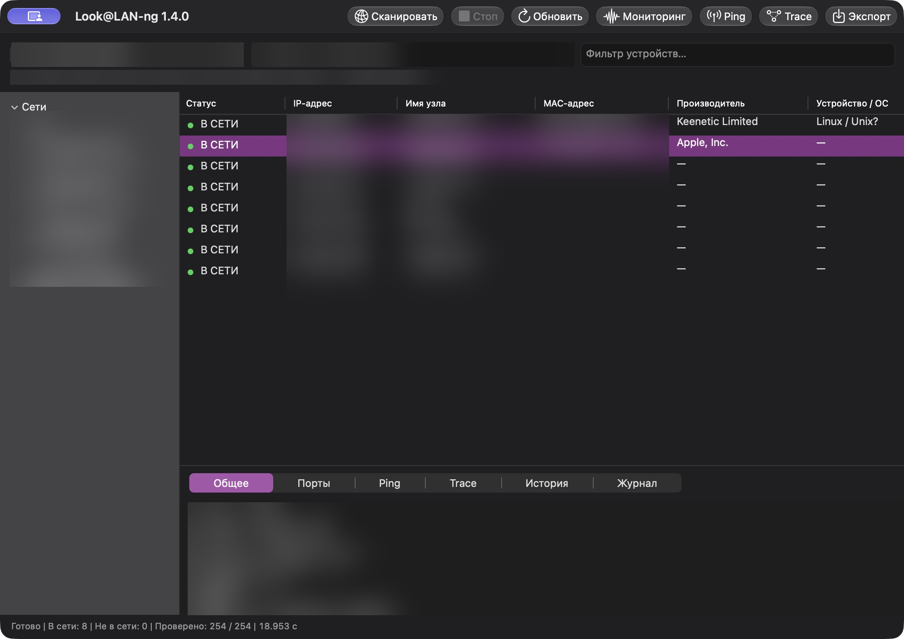
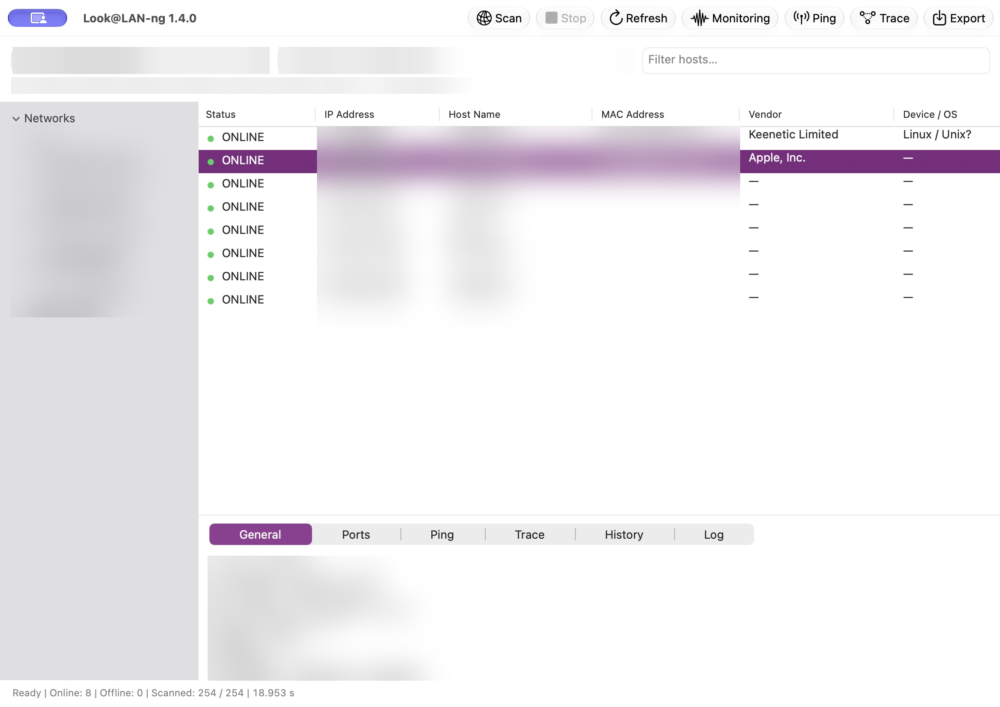

## macOS 1.4.0 — RU

Добавлена проверенная на Mac universal-поставка **arm64+x86_64**. Перенесены профили v2, временный режим без INI/каталогов настроек, постоянный режим после Save Profile и восстановление хостов/журнала после перезапуска. Cocoa: Вид → Тема → Системная / Светлая / Тёмная; выбор сохраняется только в постоянном режиме. Старый профиль отклоняется без миграции и перезаписи.

Clang 23.1.4, свежая официальная IEEE MA-L 40421; дата и SHA-256 записаны в [отчёте](https://github.com/nr084/Look-LAN-ng/blob/main/docs/MACOS_VALIDATION.md). Проверены 9/9 ARM64 и 9/9 Rosetta тестов, оба запуска подписанного app, реальная LAN 254/254 (8 узлов), RU/EN, мониторинг, CSV/TXT/HTML, Save Profile v2 и восстановление истории. Скриншоты финального app: все IP/MAC сильно размыты и проверены.

## macOS 1.4.0 — EN

Added the Mac-built and tested **arm64+x86_64** universal DMG. Includes profile v2, temporary use without settings files/directories, persistence after Save Profile, and host/event history restored across restarts. Cocoa View → Theme → System / Light / Dark; preferences persist only after enabling saved-profile mode. Legacy profiles are rejected without migration or overwriting.

Official stable Clang 23.1.4 and freshly retrieved IEEE MA-L 40421; retrieval dates and SHA-256 are recorded in the [validation report](https://github.com/nr084/Look-LAN-ng/blob/main/docs/MACOS_VALIDATION.md). Nine ARM64 and nine Rosetta tests, both signed-app smokes, actual LAN, RU/EN, monitoring, CSV/TXT/HTML, profile saving and history restoration passed. All IP/MAC address regions in the final-app screenshots are strongly blurred and reviewed.

macOS 13 deployment baseline; native Intel and older macOS not tested. Ad-hoc signed, not notarized. No supported macOS UPX packing; Mach-O retained, DMG ULMO/LZMA. Mac diagnostics stay local. Existing Windows/Linux assets and tag are preserved.

| DMG | SHA-256 |
| --- | --- |
| `look@lan-ng-macos-universal-1.4.0.dmg` | `f3172321a372a702e6cd45a9f2d112bd449bbaf85ab233e26fe0f2989865c1d7` |
